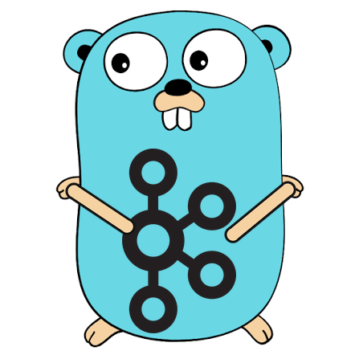

<div align="center">



# RavenMQ

**A distributed, partitioned message broker built for reliable event streaming.**

</div>

A message broker written from scratch in Go, combining a Raft-backed metadata control plane, disk-persisted append-only commit logs,
idempotent producer deduplication, consumer group rebalancing, a Go SDK, and a CLI over gRPC.

## Features

- Raft-backed cluster metadata — broker registry and topic/partition leader assignment, replicated with snapshot/restore
- Deterministic, round-robin partition-to-broker assignment on topic creation
- Idempotent produce — duplicate `(producer_id, sequence_number)` pairs are detected and skipped, even across restarts
- Append-only commit log with length-prefixed records and persisted offset/sequence state
- Consumer group rebalancing — leader election, generation fencing, round-robin partition assignment
- Heartbeat-based session liveness with automatic member eviction and rebalance triggers
- Per-group, per-partition offset commit and fetch
- Dynamic cluster membership — Coordinators can join at runtime; brokers self-register with `-advertise-addr` support
- Go SDK — `Producer` (key-hashed or round-robin routing) and `Consumer` (auto rebalance, heartbeats, offset commit)
- CLI (`ravenctl`) and Docker Compose cluster — create topics, inspect metadata, produce/consume from the terminal, and run a 5-node cluster in containers
- Single gRPC/Protobuf API surface with reflection enabled

## Project layout

```text
ravenmq/
├── api/proto/v1/          # Protobuf definitions & generated gRPC stubs
├── cmd/
│   ├── broker/            # Broker node CLI entrypoint
│   ├── coordinator/       # Raft Coordinator & GroupCoordinator CLI entrypoint
│   └── ravenctl/          # Admin & demo CLI client
├── deploy/
│   ├── Dockerfile         # Multi-stage image building coordinator, broker, and ravenctl
│   └── docker-compose.yml # 3-node Raft Coordinator + 2-Broker local cluster
├── docs/                  # Architecture notes and diagrams
├── internal/
│   ├── broker/            # Broker gRPC server implementation & tests
│   ├── coordinator/       # Raft server, FSM, snapshot/restore & tests
│   ├── groupcoord/        # Consumer group state machine & tests
│   └── store/             # Append-only CommitLog & idempotency state
└── pkg/ravenmq/           # Go Producer & Consumer SDK + end-to-end integration test

```

See [docs/Architecture.md](docs/Architecture.md) for design rationale, ADRs, and the full roadmap.

---

## Prerequisites

* Go 1.27+
* Docker & Docker Compose (optional, for running the containerized cluster)
* `protoc` with `protoc-gen-go` and `protoc-gen-go-grpc` (only needed if editing `api/proto/v1/ravenmq.proto`)
* `grpcurl` (optional, for raw gRPC inspection)

---

## Quickstart: Docker Compose cluster

Spin up a 3-node Coordinator Raft cluster (`8001`–`8003`) and 2 Brokers (`9001`–`9002`):

```bash
docker compose -f deploy/docker-compose.yml up --build -d

```

Build `ravenctl` and interact with the cluster from your host:

```bash
go build -o ./bin/ravenctl ./cmd/ravenctl

# 1. Create a 2-partition topic
./bin/ravenctl topic create -coord 127.0.0.1:8001 -name orders -partitions 2

# 2. Inspect registered brokers and partition leaders
./bin/ravenctl metadata -coord 127.0.0.1:8001

# 3. Produce keyed messages across partitions 0 and 1
./bin/ravenctl produce -coord 127.0.0.1:8001 -topic orders -key order-1 -value '{"item":"keyboard","qty":1}'
./bin/ravenctl produce -coord 127.0.0.1:8001 -topic orders -key order-2 -value '{"item":"mouse","qty":2}'

# 4. Consume in a consumer group (run in two terminals to see partition balancing)
./bin/ravenctl consume -coord 127.0.0.1:8001 -group billing -topic orders

```

Stop and remove containers and volumes:

```bash
docker compose -f deploy/docker-compose.yml down -v

```

---

## Quickstart: running a local cluster

### 1. Start the Coordinator

```bash
go run ./cmd/coordinator \
  -node-id coord-1 \
  -raft-addr 127.0.0.1:7001 \
  -grpc-addr 127.0.0.1:8001 \
  -data-dir /tmp/ravenmq/coord-1 \
  -bootstrap

```

Optional: join additional Coordinator nodes into the same Raft cluster:

```bash
go run ./cmd/coordinator \
  -node-id coord-2 \
  -raft-addr 127.0.0.1:7002 \
  -grpc-addr 127.0.0.1:8002 \
  -data-dir /tmp/ravenmq/coord-2 \
  -join 127.0.0.1:8001

```

### 2. Start Broker nodes

```bash
# Broker 1
go run ./cmd/broker \
  -broker-id 1 \
  -addr 127.0.0.1:9001 \
  -data-dir /tmp/ravenmq/broker-1 \
  -coordinator 127.0.0.1:8001

# Broker 2
go run ./cmd/broker \
  -broker-id 2 \
  -addr 127.0.0.1:9002 \
  -data-dir /tmp/ravenmq/broker-2 \
  -coordinator 127.0.0.1:8001

```

### 3. Create a topic and produce/consume

Using `ravenctl`:

```bash
go run ./cmd/ravenctl topic create -coord 127.0.0.1:8001 -name orders -partitions 2
go run ./cmd/ravenctl metadata -coord 127.0.0.1:8001
go run ./cmd/ravenctl produce -coord 127.0.0.1:8001 -topic orders -key order-1 -value 'hello'
go run ./cmd/ravenctl consume -coord 127.0.0.1:8001 -group billing -topic orders

```

Or via `grpcurl`:

```bash
# Create a 2-partition topic (partition 0 -> broker 1, partition 1 -> broker 2)
grpcurl -plaintext -d '{"topic": "orders", "partitions": 2}' \
  127.0.0.1:8001 ravenmq.v1.CoordinatorService/CreateTopic

# Inspect cluster metadata
grpcurl -plaintext \
  127.0.0.1:8001 ravenmq.v1.CoordinatorService/GetClusterMetadata

# Produce a message to partition 0
grpcurl -plaintext -d '{"topic": "orders", "partition": 0, "value": "aGVsbG8=", "producer_id": 1, "sequence_number": 1}' \
  127.0.0.1:9001 ravenmq.v1.BrokerService/Produce

# Consume from byte offset 0
grpcurl -plaintext -d '{"topic": "orders", "partition": 0, "offset": 0}' \
  127.0.0.1:9001 ravenmq.v1.BrokerService/Consume

```

---

## Go client SDK (`pkg/ravenmq`)

### Producer

```go
package main

import (
	"context"
	"log"

	"[github.com/kmr-ankitt/ravenmq/pkg/ravenmq](https://github.com/kmr-ankitt/ravenmq/pkg/ravenmq)"
)

func main() {
	ctx := context.Background()

	producer, err := ravenmq.NewProducer("127.0.0.1:8001", 100)
	if err != nil {
		log.Fatal(err)
	}
	defer producer.Close()

	offset, partition, err := producer.Send(ctx, "orders", []byte("order-42"), []byte(`{"amount":99.50}`))
	if err != nil {
		log.Fatal(err)
	}
	log.Printf("written to partition=%d offset=%d", partition, offset)
}

```

`Send` takes a topic, an optional key, and a value. A non-empty key is hashed with FNV-1a to pick a partition deterministically; an empty key falls back to round-robin. The producer caches topic-partition routes and refreshes them from the Coordinator on a cache miss.

### Consumer

```go
package main

import (
	"context"
	"log"
	"os"
	"os/signal"

	"[github.com/kmr-ankitt/ravenmq/pkg/ravenmq](https://github.com/kmr-ankitt/ravenmq/pkg/ravenmq)"
)

func main() {
	ctx, stop := signal.NotifyContext(context.Background(), os.Interrupt)
	defer stop()

	consumer, err := ravenmq.NewConsumer("127.0.0.1:8001", "billing-workers", "orders")
	if err != nil {
		log.Fatal(err)
	}
	defer consumer.Close()

	err = consumer.Run(ctx, func(ctx context.Context, msg ravenmq.Message) error {
		log.Printf("[partition=%d offset=%d] %s", msg.Partition, msg.Offset, string(msg.Value))
		return nil // commits the offset automatically
	})
	if err != nil && err != context.Canceled {
		log.Fatal(err)
	}
}

```

Multiple `Consumer` instances started with the same `groupID` and `topic` join a consumer group: the first member to join becomes the group leader, computes a round-robin partition assignment across all live members, and distributes it via `SyncGroup`. A background heartbeat loop keeps sessions alive and triggers a rebalance if a member drops out.

---

## Testing & protobuf codegen

Run the full unit and end-to-end integration suite with the race detector:

```bash
go test -race -v ./...

```

Regenerate gRPC/Protobuf Go code after editing `api/proto/v1/ravenmq.proto`:

```bash
protoc --go_out=. --go_opt=paths=source_relative \
       --go-grpc_out=. --go-grpc_opt=paths=source_relative \
       api/proto/v1/ravenmq.proto

```

---

## License

MIT — see [LICENSE](https://www.google.com/search?q=LICENSE).