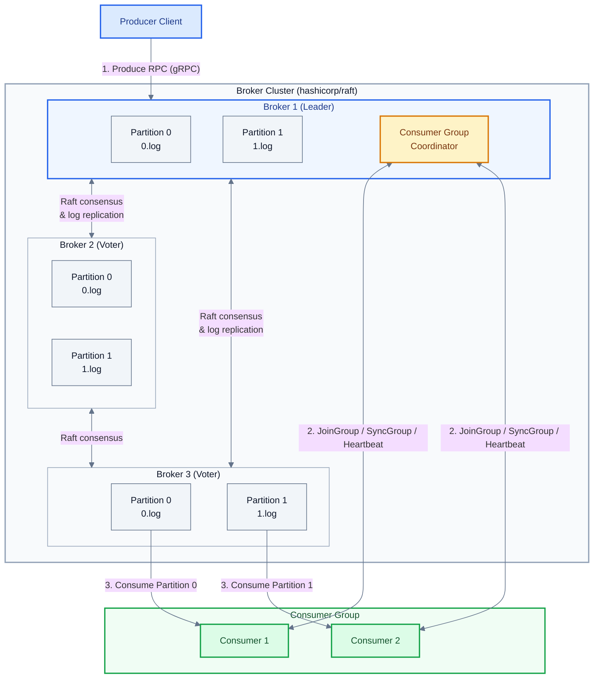
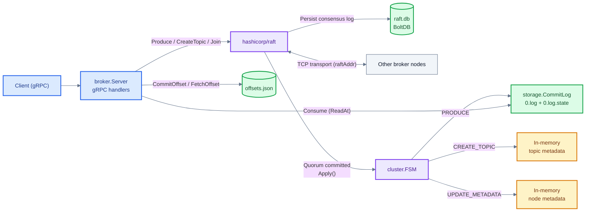
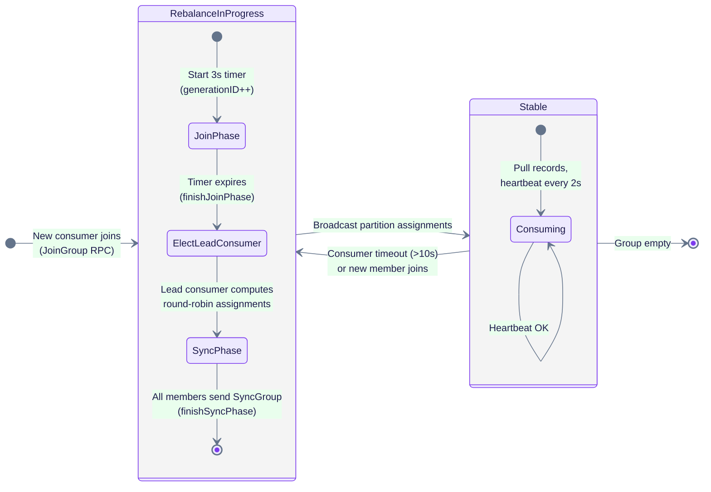
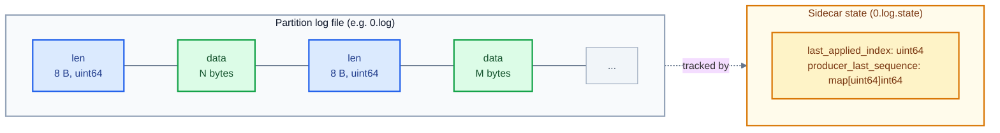

# Architecture

A Raft-replicated, partitioned commit-log broker with consumer groups, built on `hashicorp/raft` and gRPC.

| # | Section | Covers |
|---|---------|--------|
| 1 | [Cluster Overview](#1-cluster-overview--writeread-flow) | Nodes, replication, produce and consume paths |
| 2 | [Broker Internals](#2-internal-broker--raft-fsm-architecture) | gRPC server, Raft, FSM, storage |
| 3 | [Consumer Group Rebalancing](#3-consumer-group-rebalancing-state-machine) | Join, sync, stable, timeout |
| 4 | [On-Disk Layout](#4-on-disk-commit-log-layout) | `0.log` record framing and `0.log.state` sidecar |

---

## 1. Cluster Overview & Write/Read Flow

Writes go through the Raft leader and are replicated to every voter. Consumers coordinate through the group coordinator on the leader, then read partitions from any replica.

---

## 2. Internal Broker & Raft FSM Architecture

Every mutating request becomes a Raft log entry. Once a quorum commits it, `Apply()` hands it to the FSM, which updates the commit log or in-memory metadata. Reads bypass Raft and go straight to storage.

---

## 3. Consumer Group Rebalancing State Machine

A join opens a 3 second window. When it closes, one consumer is elected lead and computes round-robin assignments. The group becomes stable once every member has synced.

| Parameter | Value |
|-----------|-------|
| Join window | 3 s |
| Heartbeat interval | 2 s |
| Session timeout | 10 s |
| Assignment strategy | Round-robin, computed by the lead consumer |

---

## 4. On-Disk Commit Log Layout

Each partition is an append-only file of length-prefixed records. A sidecar file tracks the last applied Raft index and per-producer sequence numbers, which supports idempotent produce.

| Field | Size | Description |
|-------|------|-------------|
| `len` | 8 bytes | Payload length as `uint64` |
| `data` | N bytes | Record payload |
| `last_applied_index` | `uint64` | Last Raft index applied to this partition |
| `producer_last_sequence` | `map[uint64]int64` | Last sequence seen per producer, used for deduplication |