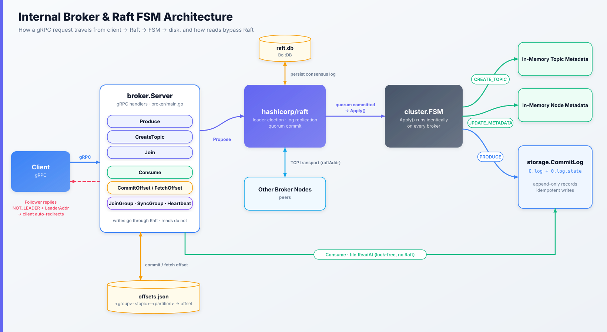
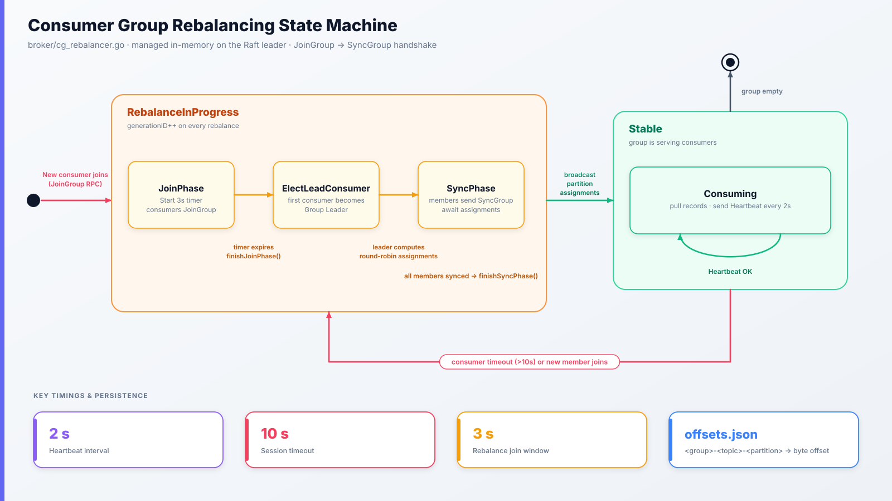
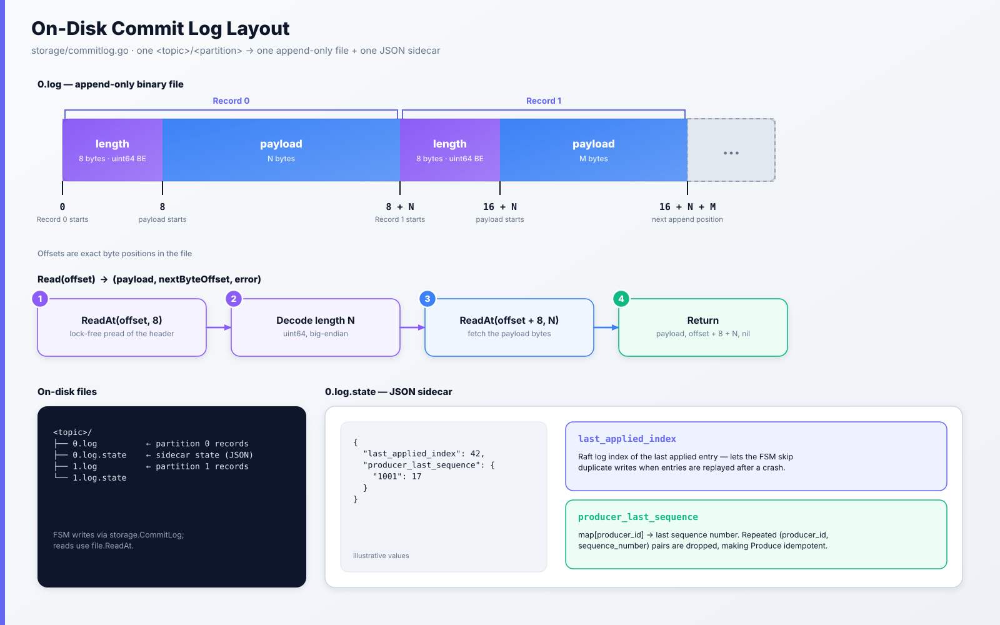

# RavenMQ — Architecture Document

RavenMQ uses Raft for cluster metadata and direct broker connections for durable message production and consumption.

## Table of Contents

1. [Goals and Non-Goals](#1-goals-and-non-goals)
2. [System at a Glance](#2-system-at-a-glance)
3. [Broker Internals: Write Path and Read Path](#3-broker-internals-write-path-and-read-path)
4. [Consumer Group Coordination](#4-consumer-group-coordination)
5. [Storage Engine](#5-storage-engine)
6. [Service Boundaries and Interaction Flows](#6-service-boundaries-and-interaction-flows)
7. [Failure Modes and Recovery](#7-failure-modes-and-recovery)
8. [Decision Log](#8-decision-log)
9. [Known Limitations and Roadmap](#9-known-limitations-and-roadmap)

---

## 1. Goals and Non-Goals

### Goals

- **Control-plane consensus, data-plane throughput.** Cluster metadata (broker registry, topics, and partition leader assignments) is replicated via Raft, while message writes and reads go directly to partition leader brokers without consensus round-trips.
- **Idempotent production.** Retries after a timeout or transient network error must not create duplicate records.
- **Kafka-style consumption.** Consumer groups with automatic leader election, round-robin partition assignment, heartbeats, and byte-offset checkpointing.
- **Small operational surface.** Two static Go binaries (`coordinator` and `broker`) with no external coordinator dependency such as ZooKeeper or etcd.

### Non-Goals (for now)

- Multi-replica partition replication (ISR) and automatic partition leader failover (see [§9](#9-known-limitations-and-roadmap)).
- Log compaction, segment rolling, retention policies, or cross-topic transactions.
- Dynamic partition reassignment across brokers when new brokers join after topic creation.

---

## 2. System at a Glance


RavenMQ separates control-plane coordination from data-plane storage across two binaries and a smart Go client SDK (`pkg/ravenmq`):

- **Coordinator (`cmd/coordinator`)**: Runs a `hashicorp/raft` cluster backed by BoltDB (`raft.db`) and co-hosts `CoordinatorService` and `GroupCoordinatorService` on a single gRPC endpoint.
- **Broker (`cmd/broker`)**: Self-registers with the Coordinator on startup, owns assigned topic partitions, and serves `BrokerService` (`Produce` and `Consume`) directly from local disk commit logs.
- **Client SDK (`pkg/ravenmq`)**: Discovers topology via `GetClusterMetadata`, caches partition routes, pools gRPC broker connections, and manages consumer group lifecycles.

### Request Routing

| Operation | Handled by | Notes |
|---|---|---|
| `JoinCluster`, `RegisterBroker`, `CreateTopic` | Coordinator Raft **leader** | Followers return `Success: false` / `ERROR_CODE_NOT_LEADER` with `LeaderAddress`. |
| `GetClusterMetadata` | Any Coordinator node | Reads consistent broker and partition leader state from the local Raft `FSM`. |
| `JoinGroup`, `SyncGroup`, `Heartbeat`, `CommitOffset`, `FetchOffset` | `GroupCoordinatorService` (on Coordinator) | Group membership and byte offsets are maintained in memory (see [§4](#4-consumer-group-coordination)). |
| `Produce` | Partition leader **Broker** | Appends directly to `<topic>/<partition>.log` with producer sequence deduplication. |
| `Consume` | Partition leader **Broker** | Positioned `ReadAt` from `<topic>/<partition>.log`, returning payload and `nextOffset`. |

---

## 3. Broker Internals: Write Path and Read Path



### 3.1 Cluster Metadata Path (Coordinator Raft FSM)

1. Brokers announce themselves on startup via `RegisterBroker(broker_id, grpc_addr)` (with retries during leader election).
2. Clients or operators create topics via `CreateTopic(topic, partitions)`.
3. The Coordinator Raft leader serializes a `Command` (`register_broker` or `create_topic`) and proposes it to `hashicorp/raft`.
4. Once committed by quorum, `coordinator.FSM.Apply()` updates the broker registry or assigns partitions deterministically across sorted broker IDs using round-robin (`brokerIDs[p % len(brokerIDs)]`).
5. Snapshots (`FSM.Snapshot` / `FSM.Restore`) serialize the broker and topic maps as JSON so new or restarting Coordinators recover topology rapidly.

### 3.2 Write Path (`Produce`)

1. The `Producer` SDK (`pkg/ravenmq`) fetches and caches partition leader addresses via `GetClusterMetadata`.
2. It picks a partition via FNV-1a key hashing (when a key is provided) or atomic round-robin, increments its per-`(topic, partition)` sequence counter, and sends `Produce` directly to the leader `Broker`.
3. `broker.Server` opens or retrieves the partition's `CommitLog` and calls `AppendIdempotent(producer_id, sequence_number, value)`.
4. If `sequence_number <= lastSeq` for that `producer_id`, the duplicate is skipped and offset `-1` is returned.
5. Otherwise, the record is appended to `<partition>.log`, `SetCommitLogState` persists the updated sequence number to `<partition>.log.state`, and the record's starting byte offset is returned.

### 3.3 Read Path (`Consume`)

`Consume` reads directly from the partition leader's `CommitLog` via `Read(offset)`, which performs positioned `file.ReadAt` calls without holding a write lock and returns `(record.Value, record.Offset = nextByteOffset, error)`. At end-of-log, the broker returns `ERROR_CODE_OFFSET_OUT_OF_BOUNDS`.

---

## 4. Consumer Group Coordination



Group membership and offset tracking are implemented in `internal/groupcoord/server.go` and exposed via `GroupCoordinatorService`.

### 4.1 Rebalance Protocol

| Step | RPC | Behaviour |
|---|---|---|
| 1. Join | `JoinGroup` | Evicts expired members, assigns a unique `member_id` if empty, increments `generation_id` for new members, elects a deterministic `leader_id`, and returns the sorted `members` list only to the leader. |
| 2. Settle & Assign | `JoinGroup` + `SyncGroup` | On initial join, the elected group leader consumer waits a brief `150 ms` settle window, re-joins to capture concurrent joiners, computes **round-robin** partition assignments across `members`, and submits them in `SyncGroup`. |
| 3. Sync | `SyncGroup` | Validates `generation_id`, stores assignments on the group state, and returns each caller's `assigned_partitions`. Followers syncing before assignments land retry automatically. |
| 4. Steady State | `Heartbeat` + `Consume` | Consumers poll assigned partitions, commit byte offsets via `CommitOffset`, and send `Heartbeat` every `3 s`. If a member times out (`> 10 s`), `evictExpiredLocked` bumps `generation_id` and active members receive `ERROR_CODE_REBALANCE_IN_PROGRESS`. |

### 4.2 Timings

| Parameter | Value | Location | Role |
|---|---|---|---|
| Heartbeat interval | **3 s** | `pkg/ravenmq/consumer.go` | Consumer session liveness signal |
| Session timeout | **10 s** | `internal/groupcoord/server.go` | Declares an unresponsive member dead and bumps `generation_id` |
| Leader join settle window | **150 ms** | `pkg/ravenmq/consumer.go` | Allows concurrent consumers to join before initial partition assignment |
| Consumer poll interval | **100 ms** | `pkg/ravenmq/consumer.go` | Sleep interval when all assigned partitions are at EOF |

---

## 5. Storage Engine



### 5.1 File Layout

Each `<topic>/<partition>` maps to two files under the broker's `--data-dir`:

```text
<data-dir>/<topic>/
├── 0.log          # append-only records
└── 0.log.state    # JSON sidecar (idempotency + replay metadata)

```

Records are written sequentially as `[8-byte big-endian uint64 length][N-byte payload]`.

### 5.2 Offsets Are Byte Positions

| Property | Consequence |
| --- | --- |
| Offset = byte position of a record's 8-byte length header | `Read(offset)` requires **no separate index**: it reads 8 bytes, decodes `N`, and reads `N` bytes via `ReadAt`. |
| `nextOffset = offset + 8 + N` | Returned in `Record.offset` so consumers advance directly to the next record boundary. |
| Offsets are **non-dense** | Lag and positions are byte offsets rather than sequential message numbers (`0, 1, 2…`). |

### 5.3 The `.state` Sidecar

```json
{
  "last_applied_index": 0,
  "producer_last_sequence": {
    "100": 42
  }
}

```

| Field | Purpose |
| --- | --- |
| `producer_last_sequence` | Maps `producer_id → last_sequence_number`. Any retried write with `sequence_number <= last_sequence_number` is skipped, surviving broker restarts. |
| `last_applied_index` | Tracks the last applied entry offset/index in the sidecar metadata. |

---

## 6. Service Boundaries and Interaction Flows

### 6.1 Components

| # | Component | Binary / Package | Plane | Responsibility |
| --- | --- | --- | --- | --- |
| 1 | **Coordinator** | `cmd/coordinator`, `internal/coordinator` | Control | Raft-backed cluster topology: broker registry, topics, deterministic partition leaders. |
| 2 | **Consumer Group** | `internal/groupcoord` *(co-hosted on Coordinator)* | Control | `JoinGroup`, `SyncGroup`, `Heartbeat`, `CommitOffset`, `FetchOffset`. |
| 3 | **Broker** | `cmd/broker`, `internal/broker`, `internal/store` | Data | gRPC `Produce` / `Consume` and disk-backed commit logs. |
| 4 | **Client SDK** | `pkg/ravenmq` | Client | Topology caching, key/round-robin routing, group leader assignment, heartbeats, offset commits. |

### 6.2 Interaction Flows

| Flow | Direction | Purpose |
| --- | --- | --- |
| ① Discover topology | SDK → Coordinator | `GetClusterMetadata` fetches broker addresses and partition leaders. |
| ② Join group, heartbeat & offsets | Consumer SDK → GroupCoordinator | Group rebalancing, liveness checks, and byte-offset checkpointing. |
| ③ Produce & consume records | Producer/Consumer SDK → Broker | Direct data-plane RPCs; the Coordinator is **not** in the message hot path. |
| ④ Broker self-registration | Broker → Coordinator | `RegisterBroker` announces broker availability on startup. |

---

## 7. Failure Modes and Recovery

| Failure | Behaviour | Recovery |
| --- | --- | --- |
| **Coordinator follower crashes** | Quorum remains available (`2 of 3`); metadata mutations and `GroupCoordinator` continue. | On restart, the follower catches up via Raft log replication or snapshot restore. |
| **Coordinator leader crashes** | Raft elects a new leader; `RegisterBroker` / `CreateTopic` return `NOT_LEADER` during election. | Brokers and clients retry against the new `LeaderAddress`. |
| **Broker restarts** | `<partition>.log` and `<partition>.log.state` remain on disk. | On reopen, `NewCommitLog` restores file size and `producer_last_sequence`, preserving idempotency and offsets. |
| **Client retries `Produce` after timeout** | Duplicate `(producer_id, sequence_number)` reaches the leader broker. | `AppendIdempotent` skips the write and returns `-1`. |
| **Consumer crashes or hangs** | No `Heartbeat` received within `10 s`. | `evictExpiredLocked` removes the member and bumps `generation_id`; surviving consumers receive `ERROR_CODE_REBALANCE_IN_PROGRESS` and redistribute partitions. |
| **Coordinator restarts** | Raft topology recovers from `raft.db` and snapshots; in-memory group state resets. | Consumers re-join automatically (`JoinGroup`) and resume from their last known offsets. |

---

## 8. Decision Log

### ADR-001 — Raft via `hashicorp/raft` for Control-Plane Consensus

* **Context.** Cluster topology (registered brokers and partition leader assignments) must be strongly consistent without external dependencies like ZooKeeper.
* **Decision.** Use `hashicorp/raft` with `raft-boltdb` in `internal/coordinator`.
* **Trade-off.** Adds Raft operational concepts (bootstrapping, `AddVoter`, snapshots) in exchange for battle-tested leader election and replication.

### ADR-002 — Separate Control Plane (Raft) from Data Plane (Direct Broker Writes)

* **Context.** Routing every message payload through a single Raft group bottlenecks write throughput.
* **Decision.** Replicate only cluster metadata through Raft; partition `Produce` and `Consume` go directly to the partition's assigned leader broker.
* **Trade-off.** High single-partition write speed and horizontal scaling across brokers, at the cost of requiring follower replication (ISR) to be added separately for partition-level fault tolerance.

### ADR-003 — Byte Offsets Without a Separate Index File

* **Decision.** Use the record's byte offset in `<partition>.log` directly as its offset (`[8-byte length][payload]`).
* **Why.** `Read(offset)` is O(1) via `file.ReadAt` with zero index maintenance.
* **Trade-off.** Offsets are non-dense and require segmented logs + sparse indexes before log truncation or retention can be added.

### ADR-004 — Sidecar `.state` File for Idempotency

* **Decision.** Persist `producer_last_sequence` in `<partition>.log.state` alongside `<partition>.log`.
* **Why.** Keeps deduplication state local to each partition log across broker restarts without external state stores.

### ADR-005 — Client-Side Partition Assignment in Consumer Groups

* **Decision.** `GroupCoordinatorService` elects the group leader and distributes assignments, while the elected `Consumer` SDK computes round-robin partition mappings.
* **Why.** Keeps assignment strategies flexible in `pkg/ravenmq` without requiring broker or coordinator changes.

### ADR-006 — gRPC and Protocol Buffers (`api/proto/v1/ravenmq.proto`)

* **Decision.** Define `BrokerService`, `CoordinatorService`, and `GroupCoordinatorService` in `api/proto/v1/ravenmq.proto` with server reflection enabled.
* **Why.** Provides strongly typed Go stubs and easy inspection via `grpcurl`.

---

## 9. Known Limitations and Roadmap

| # | Limitation | Impact | Next Step |
| --- | --- | --- | --- |
| 1 | **No partition replication (ISR)** | If a broker's disk is lost, its partitions have no warm follower replica. | Replicate partition appends from leader broker to follower brokers and support `ACK_LEVEL_ALL`. |
| 2 | **In-memory consumer group offsets** | Committed offsets in `internal/groupcoord` are lost if the Coordinator restarts. | Replicate `CommitOffset` entries through the Coordinator Raft `FSM` (or persist to BoltDB). |
| 3 | **Single-file partition logs** | Logs grow unbounded without segment rolling or retention. | Split logs into fixed-size segments with sparse offset indexes and time/size retention cleanup. |
| 4 | **Stop-the-world group rebalances** | Partition consumption pauses briefly whenever a consumer joins or leaves. | Implement incremental cooperative rebalancing and static member IDs. |
| 5 | **No TLS, auth, or HTTP metrics gateway** | Plaintext gRPC only; no Prometheus lag/throughput endpoint. | Add mTLS credentials and an optional HTTP/Prometheus gateway service. |