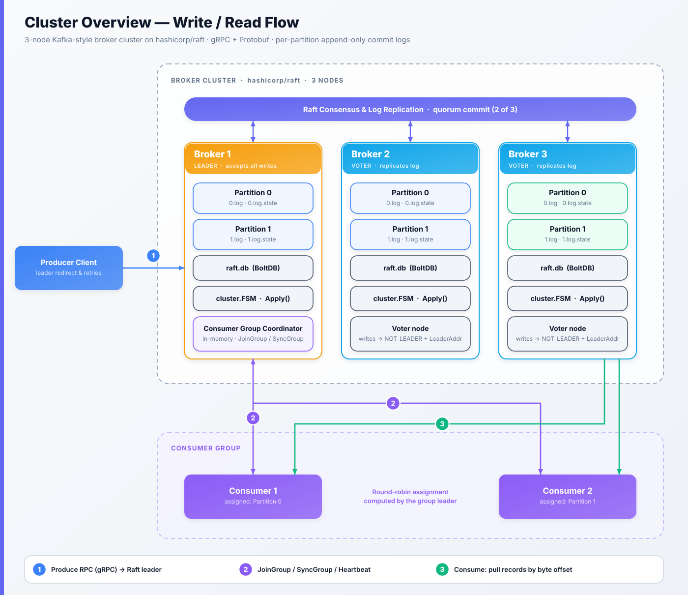
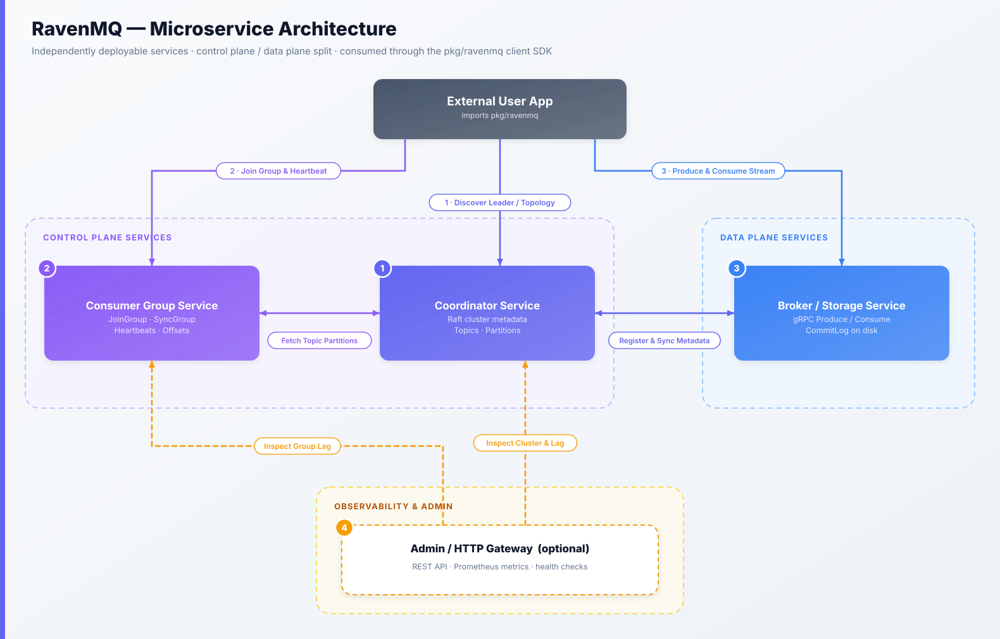

# RavenMQ — Architecture Document

> A distributed, fault-tolerant, Kafka-inspired message broker written in Go.

**Stack:** Go · gRPC + Protocol Buffers · HashiCorp Raft + BoltDB · custom append-only commit log

---

## Table of Contents

1. [Goals and Non-Goals](#1-goals-and-non-goals)
2. [System at a Glance](#2-system-at-a-glance)
3. [Broker Internals: Write Path and Read Path](#3-broker-internals-write-path-and-read-path)
4. [Consumer Group Coordination](#4-consumer-group-coordination)
5. [Storage Engine](#5-storage-engine)
6. [Microservice Architecture](#6-microservice-architecture)
7. [Failure Modes and Recovery](#7-failure-modes-and-recovery)
8. [Decision Log](#8-decision-log)
9. [Known Limitations and Roadmap](#9-known-limitations-and-roadmap)

---

## 1. Goals and Non-Goals

### Goals

- **Durability and consistency first.** An acknowledged write must survive the loss of a minority of nodes.
- **Simple, auditable correctness.** A single consensus mechanism (Raft) governs every state change, so there is one place to reason about ordering.
- **Idempotent production.** Retries after a timeout or leader change must not create duplicate records.
- **Kafka-style consumption.** Consumer groups with automatic partition assignment, heartbeats, and committed offsets.
- **Small operational surface.** A single static Go binary per node, with no external coordinator such as ZooKeeper.

### Non-Goals (for now)

- Matching Kafka's throughput. Writes are serialised through one Raft leader (see [ADR-002](#adr-002--one-raft-group-for-the-whole-cluster)).
- Log compaction, tiered storage, transactions, or exactly-once semantics across topics.
- Dynamic partition rebalancing across brokers, because every broker currently holds every partition.

---

## 2. System at a Glance



A cluster of three brokers uses `hashicorp/raft` to elect one leader and two voters. Every broker stores every partition, so any node can serve reads after a leader failure.

**Request routing**

| Operation | Handled by | Notes |
|---|---|---|
| `Produce`, `CreateTopic`, `Join` | Raft **leader** only | Followers reply `NOT_LEADER` + `LeaderAddr`; the client redirects and retries. |
| `JoinGroup`, `SyncGroup`, `Heartbeat` | Group coordinator (on the leader) | State is in-memory (see §4). |
| `Consume` | Any broker | Direct file read, with no Raft round-trip. |
| `CommitOffset`, `FetchOffset` | Broker-local `offsets.json` | Keyed by `<group>-<topic>-<partition>`. |

**Rationale.** Routing all mutations through a single replicated log provides a total order. Every broker applies the same committed entries in the same order, so the logs converge byte for byte. The trade-off is a single write leader (§9).

---

## 3. Broker Internals: Write Path and Read Path


### 3.1 Write path (`Produce`)

1. The client sends a `Produce` RPC to `broker.Server`. A non-leader node rejects it with `NOT_LEADER` and returns `LeaderAddr`.
2. The leader serialises the command and **proposes** it to `hashicorp/raft`.
3. Raft appends the entry to its own log in `raft.db` (BoltDB), then replicates it to peers over the TCP transport (`raftAddr`).
4. Once a **quorum (2 of 3)** has the entry, it is committed, and `cluster.FSM.Apply()` runs on every broker.
5. The FSM dispatches on the command type:
   - `PRODUCE` → `storage.CommitLog.Append(...)`
   - `CREATE_TOPIC` → in-memory topic metadata
   - `UPDATE_METADATA` → in-memory node metadata
6. The leader acknowledges the request only after its local `Apply()` completes.

### 3.2 Read path (`Consume`)

`Consume` bypasses Raft entirely. The handler calls `CommitLog.Read(offset)`, which uses `file.ReadAt` and returns `(payload, nextByteOffset, error)`. Reads therefore scale with the number of replicas and do not contend with the writer.

### 3.3 Why a Raft log *and* a commit log?

There are two logs, with different jobs:

| | Raft log (`raft.db`) | Commit log (`<partition>.log`) |
|---|---|---|
| **Purpose** | Consensus: ordering and replication of *commands* | Application data: the records consumers read |
| **Format** | BoltDB (managed by `raft-boltdb`) | Custom `[len][payload]` binary file |
| **Consumers read it?** | No | Yes |
| **Truncation** | Raft snapshots and compaction | Not yet (see §9) |

The trade-off is that every record is written **twice** on each node: once to the Raft log and once to the commit log. This preserves the consensus library's standard behaviour and keeps the consumer-facing format simple. The write path can be optimised later without changing the protocol.

---

## 4. Consumer Group Coordination


Group membership is managed by `broker/cg_rebalancer.go` and held **in memory by the Raft leader**.

### 4.1 State machine

| State | Meaning | Exit condition |
|---|---|---|
| `RebalanceInProgress` → **JoinPhase** | A 3 s window opens, and `generationID` is incremented. Members call `JoinGroup`. | Timer expires (`finishJoinPhase`). |
| → **ElectLeadConsumer** | The first consumer becomes the *group leader*. | Immediately. |
| → **SyncPhase** | The group leader computes **round-robin** assignments. Members call `SyncGroup`. | All members have synced (`finishSyncPhase`). |
| `Stable` | Consumers pull records and heartbeat every 2 s. | Member timeout (>10 s) or a new member joins. |
| *(end)* | Group is empty. | n/a |

### 4.2 Timings

| Parameter | Value | Role |
|---|---|---|
| Heartbeat interval | **2 s** | Consumer liveness signal |
| Session timeout | **10 s** | Declares a member dead and triggers a rebalance |
| Rebalance join window | **3 s** | How long the coordinator waits for members to join before assigning |

The 5:1 ratio between the session timeout and heartbeat interval tolerates several lost heartbeats before a healthy consumer is evicted. This follows the conventional Kafka configuration pattern.

### 4.3 Design notes

- **Client-side assignment.** The coordinator only elects a group leader. The *consumer* computes the assignment, keeping assignment-strategy code out of the broker and allowing strategies to evolve in the client library.
- **Stop-the-world rebalance.** Every membership change pauses the group for the join window and sync phase. This is simple and correct, but it is the primary source of consumption latency during deployments (see §9).
- **Offsets** are committed to the broker's `offsets.json` as `<group>-<topic>-<partition> → byte_offset`. Because offsets are byte positions, a consumer resumes exactly where it stopped without an additional lookup.

---

## 5. Storage Engine


### 5.1 File layout

Each `<topic>/<partition>` maps to two files:

```text
<topic>/
├── 0.log          # append-only records
└── 0.log.state    # JSON sidecar (idempotency + replay safety)
```

Records are laid out back to back as `[8-byte big-endian uint64 length][N-byte payload]`.

### 5.2 Offsets are byte positions

| Property | Consequence |
|---|---|
| Offset = byte position of a record's length header | `Read(offset)` needs **no index**: it reads 8 bytes, decodes N, then reads N bytes. |
| `nextByteOffset = offset + 8 + N` | The client can resume or poll without extra bookkeeping. |
| Offsets are **not dense** (they do not count 0, 1, 2…) | Consumer lag is measured in bytes, not messages. Offsets cannot be guessed. |

### 5.3 The `.state` sidecar

| Field | Purpose |
|---|---|
| `last_applied_index` | The Raft index of the last entry applied. If Raft replays entries after a crash, `Apply()` **skips anything at or below this index**, so records are never appended twice. |
| `producer_last_sequence` | `map[producer_id] → sequence`. A repeated `(producer_id, sequence_number)` is dropped, which makes `Produce` **idempotent** across client retries and leader changes. |

### 5.4 Design notes

- **Concurrent reads.** `ReadAt` is a positioned read that does not move a shared file cursor, so concurrent readers do not need a mutex. Only the FSM goroutine appends, so there is **one writer per file by construction**.
- **Durability depends on the fsync policy.** The Raft log provides crash safety for commands, but the commit log's guarantees depend on when it is flushed. The policy should be explicit (per append, batched, or OS-managed) and documented.
- **Crash window between data and state.** The log append and `.state` update are separate writes. If the process exits between them, replay must detect and repair the gap. This is the first area to cover with crash-injection tests.

---

## 6. Microservice Architecture



The monolithic broker (§2–§5) is being decomposed into **independently deployable services** behind the `pkg/ravenmq` client SDK. The split follows the **control-plane/data-plane** boundary.

### 6.1 Services

| # | Service | Plane | Responsibility |
|---|---|---|---|
| 1 | **Coordinator** | Control | Raft-backed cluster metadata: leader discovery, topics, partitions, node registry. Source of truth for topology. |
| 2 | **Consumer Group** | Control | `JoinGroup`, `SyncGroup`, heartbeats, committed offsets. |
| 3 | **Broker / Storage** | Data | gRPC `Produce` / `Consume` and the on-disk commit log. The hot path. |
| 4 | **Admin / HTTP Gateway** *(optional)* | Operations | REST API, Prometheus metrics, and health checks. Read-only view of services 1 and 2. |

### 6.2 Interaction flows

| Flow | Direction | Purpose |
|---|---|---|
| ① Discover leader / topology | App → Coordinator | The SDK discovers traffic destinations and caches the result. |
| ② Join group and heartbeat | App → Consumer Group | Membership and partition assignment. |
| ③ Produce and consume stream | App → Broker | Direct data traffic. The Coordinator is **not** in the data path. |
| Register and sync metadata | Broker ↔ Coordinator | Brokers register themselves and receive topic and partition changes. |
| Fetch topic partitions | Consumer Group ↔ Coordinator | Assignments require current partition counts. |
| Inspect cluster and lag | Gateway → Coordinator, Consumer Group | Read-only access for dashboards and operations. |

### 6.3 Why split this way

- **Independent scaling.** The data plane is I/O-bound and requires disk capacity and bandwidth. The control plane has low resource requirements but frequent interactions. They should not share a scaling unit.
- **Blast-radius isolation.** A rebalance storm in the Consumer Group service cannot starve `Produce` traffic on the Broker.
- **Different consistency requirements.** Topology must be strongly consistent through Raft. Group state is ephemeral and can be rebuilt when members rejoin.
- **Optional observability.** The Gateway is deliberately off the critical path. Losing it affects visibility but not availability.

### 6.4 Trade-offs of the split

| Benefit | Cost |
|---|---|
| Independent deployment, scaling, and failure domains | More processes to run, secure, and upgrade. Requires service discovery and mTLS. |
| Clear ownership boundaries and smaller codebases | Cross-service API versioning. Protobuf contracts must remain backward compatible. |
| Minimal data path | The SDK carries more logic (topology caching, retries, and redirects), so SDK defects affect every user. |
| Gateway can evolve independently | A stale SDK topology cache can briefly route requests to the wrong node. The cache must be invalidated on `NOT_LEADER`. |

**Recommendation.** Initially ship the split as *modes of a single binary* (`--role=coordinator|group|broker|gateway|all`). This preserves the one-binary operating model for small deployments while allowing larger deployments to run roles separately.

---

## 7. Failure Modes and Recovery

| Failure | Behaviour | Recovery |
|---|---|---|
| **Follower crashes** | The quorum (2 of 3) remains available, so writes continue. | On restart, the follower catches up through Raft replication or a snapshot. |
| **Leader crashes** | Writes stall during the election and resume under the new leader. | Clients receive `NOT_LEADER`, rediscover the leader, and retry. Idempotency prevents duplicates. |
| **Two nodes lost** | No quorum remains, so writes are refused. Reads from the survivor may continue but can be stale. | Restore a node to regain quorum. Raft cannot elect a leader without a majority, preventing split-brain. |
| **Crash during `Apply`** | Raft replays the entry. | `last_applied_index` makes replay a no-op for entries already written. |
| **Client retry after timeout** | The same `(producer_id, sequence)` may arrive twice. | Dropped by `producer_last_sequence`. |
| **Consumer dies** | No heartbeat for 10 s. | Group moves to `RebalanceInProgress` and its partitions are reassigned. |
| **Group leader fails over** | In-memory group state is lost. | Members rejoin under a new generation. Committed offsets are not affected. See the §9 caveat about `offsets.json` replication. |
| **Network partition** | The minority side cannot commit. | The partition heals automatically, and the old leader steps down. |

---

## 8. Decision Log

### ADR-001 — Raft via `hashicorp/raft` instead of a bespoke protocol

- **Context.** We need strongly consistent replication with leader election.
- **Decision.** Use `hashicorp/raft` with `raft-boltdb` for log and stable storage.
- **Alternatives.** Hand-rolled Raft; Paxos; an external coordinator (etcd or ZooKeeper).
- **Why.** The library is used in production by projects such as Consul and Nomad, and removes the most error-prone implementation work. It also avoids an external coordinator dependency.
- **Trade-off.** We inherit its operational model (snapshots, membership changes) and its performance envelope. BoltDB is not the fastest log store.

### ADR-002 — One Raft group for the whole cluster

- **Decision.** All topics and partitions share a single Raft group and a single leader.
- **Alternatives.** One Raft group per partition (as in CockroachDB or TiKV). Per-partition leaders with ISR (as in Kafka).
- **Why.** It is the simplest correct design. There is one total order, one election, and one membership view.
- **Trade-off.** **Write throughput is bounded by one leader**, and every broker stores every partition. This is a scalability limit rather than a correctness flaw. Sharding partitions across multiple Raft groups is the primary upgrade path.

### ADR-003 — Quorum commit before acknowledging

- **Decision.** Acknowledge `Produce` only after the entry is committed (2 of 3).
- **Why.** An acknowledged record survives any single node loss, which matches the durability goal.
- **Trade-off.** Latency includes at least one replication round-trip. There is no `acks=0/1` fast mode.

### ADR-004 — Reads bypass Raft

- **Decision.** `Consume` reads directly from local disk on any replica.
- **Why.** It maximises read throughput and keeps reads off the consensus path.
- **Trade-off.** A lagging follower can serve **slightly stale** data, and consumers may see a short delay before new records appear. This is acceptable for a log, where consumers already tolerate lag. If linearizable reads are required, add a read-index or leader-only read mode.

### ADR-005 — Byte offsets, no index

- **Decision.** Offset = byte position in the `.log` file.
- **Why.** `Read` is O(1), with no index to build, persist, or corrupt, and the format is simple.
- **Trade-off.** Offsets are non-dense and opaque. There is no efficient seek-by-timestamp or message number, no segment rolling, and retention or compaction cannot simply delete a prefix, because that would shift every offset. Moving to segmented files with a sparse index (Kafka's approach) fixes all of these, at the cost of complexity.

### ADR-006 — Sidecar state file for idempotency

- **Decision.** Persist `last_applied_index` and `producer_last_sequence` in `<partition>.log.state`, next to the data.
- **Why.** Co-locating state with the log keeps idempotency checks local and avoids an additional lookup service.
- **Trade-off.** Data and state are updated by separate writes, creating a crash window that requires careful ordering and testing (§5.4). The state file is rewritten on each update, which is acceptable at low rates but should become incremental under load.

### ADR-007 — In-memory consumer-group state on the leader

- **Decision.** Group membership and generations live in memory on the Raft leader.
- **Why.** Group state is ephemeral, and members can reconstruct it by rejoining. Keeping heartbeats out of Raft avoids sending a high-frequency, low-value stream through consensus.
- **Trade-off.** Leader failover forces every group to rebalance. This brief pause is accepted in exchange for a simpler, faster coordinator.

### ADR-008 — Client-side partition assignment

- **Decision.** The elected *group leader consumer* computes assignments (round-robin).
- **Why.** It keeps assignment logic out of the broker, allowing strategies to change without a broker release.
- **Trade-off.** Correctness depends on client implementations. A buggy client can produce overlapping or incomplete assignments, so the server should validate the result.

### ADR-009 — gRPC and Protocol Buffers

- **Decision.** All client and inter-service APIs are defined in `api/kafka.proto`.
- **Why.** It provides a strongly typed schema, generated clients, HTTP/2 streaming, and straightforward backward-compatible evolution.
- **Trade-off.** Less friendly to ad-hoc tooling than plain HTTP and JSON. The optional Gateway (§6) exists partly to fill this gap.

### ADR-010 — Control-plane / data-plane service split

- **Decision.** Decompose into Coordinator, Consumer Group, Broker, and an optional Gateway (§6).
- **Why.** It enables independent scaling, isolation, and clearer ownership.
- **Trade-off.** More operational surface, and the SDK carries topology logic. See §6.4. Mitigate by shipping as roles of one binary.

---

## 9. Known Limitations and Roadmap

Ordered roughly by impact.

| # | Limitation | Impact | Suggested direction |
|---|---|---|---|
| 1 | **Single write leader** (ADR-002) | Throughput ceiling. All brokers hold all data. | Shard partitions across multiple Raft groups. |
| 2 | **No retention, compaction, or segments** (ADR-005) | Logs grow without bound. | Segmented log plus sparse index, time and size retention. |
| 3 | **`offsets.json` is broker-local** | If it is not replicated through Raft, committed offsets can be lost or diverge after failover. This needs verification. | Commit offsets through Raft, or store them in an internal compacted topic. |
| 4 | **Double write per record** (Raft log + commit log) | Write amplification. | Batch appends, tune Raft, or share the storage layer. |
| 5 | **Stop-the-world rebalances** | Consumption pauses during joins and leaves. | Incremental cooperative rebalancing, plus static membership for rolling deploys. |
| 6 | **Crash window between data and `.state`** | Possible gap after a crash at the wrong instant. | Define write ordering, add checksums, and add crash-injection tests. |
| 7 | **Stale reads on followers** (ADR-004) | A consumer may briefly lag the leader. | Optional leader-read or read-index mode. |
| 8 | **Fixed 3-node bootstrap** | Limited fault tolerance (one node). | Dynamic membership and 5-node clusters. |
| 9 | **No auth, TLS, or quotas** | Not safe on untrusted networks. | mTLS between services, per-client auth and quotas. |
| 10 | **Observability** | Hard to operate without metrics. | Prometheus metrics (lag, ISR/quorum, rebalances) through the Gateway. |

**Suggested test strategy.** Treat the distributed behaviour as the product. Prioritise Jepsen-style fault injection (leader kill, partition, clock skew), crash-replay tests for `last_applied_index`, and property tests for the idempotency path.

---